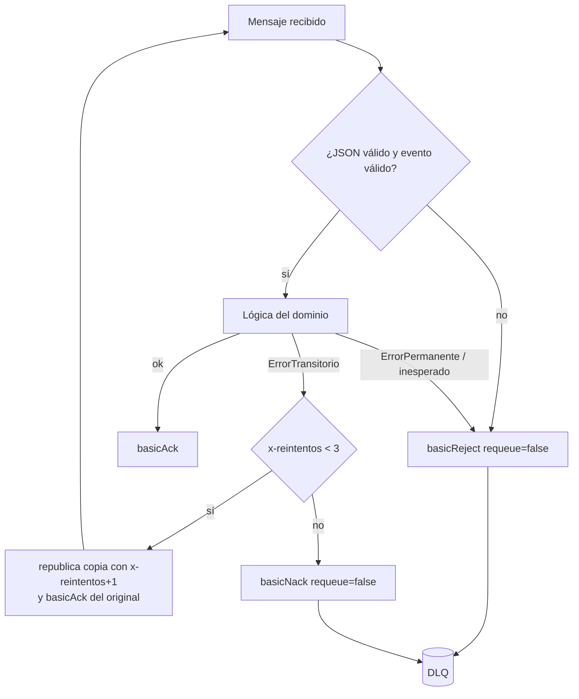

# Pedidos360 · Mensajería asíncrona con RabbitMQ (EP3 / EP4)

Este documento describe cómo Pedidos360 incorpora RabbitMQ para manejar tareas asíncronas (notificaciones, tickets y documentos) sin tocar la lógica existente del backend EA1. Cada sección indica qué indicador de la pauta `EP3_DSY1107_Estudiante_encargo.pdf` cumple.

## 1. Arquitectura

```mermaid
flowchart LR
    FE[Frontend / cliente REST] -->|POST /api/eventos/pedidos| PM[pedidos-mensajeria-ms :8091]
    BE[backend EA1 :8080] -->|POST/PUT /pedidos publica| EV
    ADM[Operador] -->|REST /api/rabbitmq/*| RA[rabbit-admin-ms :8097]

    subgraph Cluster RabbitMQ 3 nodos · colas quorum
      EV{{pedidos.eventos<br/>topic}}
      DOC{{pedidos.documentos<br/>direct}}
      DLX{{pedidos.dlx<br/>direct}}
      NQ[(notificaciones.queue)]
      TQ[(tickets.queue)]
      DQ[(documentos.queue)]
      NDLQ[(notificaciones.dlq)]
      TDLQ[(tickets.dlq)]
      DDLQ[(documentos.dlq)]
      EV -- "pedido.#" --> NQ
      EV -- "pedido.creado" --> TQ
      DOC -- "documento.factura" --> DQ
      NQ -. dead letter .-> DLX
      TQ -. dead letter .-> DLX
      DQ -. dead letter .-> DLX
      DLX -- notificaciones.dead --> NDLQ
      DLX -- tickets.dead --> TDLQ
      DLX -- documentos.dead --> DDLQ
    end

    PM -->|productor| EV
    PM -->|productor| DOC
    NQ --> C1[NotificacionConsumer]
    TQ --> C2[TicketConsumer]
    DQ --> C3[DocumentoConsumer]
    NDLQ & TDLQ & DDLQ --> C4[DlqConsumer · log de auditoría]
    RA -->|RabbitAdmin| EV
```

| Componente | Ruta | Rol |
|---|---|---|
| `backend/` | EA1 + productor AMQP | API de pedidos con JWT de Cognito; publica `CREADO`/`ACTUALIZADO` (`messaging/PedidoEventPublisher`) |
| `messaging/pedidos-mensajeria-ms` | Spring Boot 3.3 · Java 21 | Productor y consumidores (3 dominios + DLQ) |
| `messaging/rabbit-admin-ms` | Spring Boot 3.3 · Java 21 | Administrador: colas, exchanges, bindings, alertas |
| `messaging/docker-compose.yml` | 3 nodos `rabbitmq:4-management` + 2 microservicios | Clúster local / en EC2 |
| `terraform-rabbitmq/` | EC2 + ECR + Security Group | Despliegue EP4 en AWS |

## 2. Síncrono vs. asíncrono (guía 2.1.1)

| | HTTP/REST (síncrono) | AMQP con RabbitMQ (asíncrono) |
|---|---|---|
| Acoplamiento | El llamador espera al receptor; si el receptor cae, la petición falla | El productor solo necesita al broker; el consumidor puede estar caído y procesa después |
| Respuesta | `200/201` con el resultado | `202 Accepted`: el evento quedó guardado, el trabajo ocurre después |
| Picos de carga | Se propagan al receptor | La cola los absorbe (`prefetch: 1`, concurrencia 1-3) |
| Uso en Pedidos360 | Consultar/crear pedidos (`backend`) | Correos, tickets, facturas: tareas lentas que no deben bloquear al usuario |

## 3. Topología centralizada (indicadores 1, 2 y 3)

- **Nombres centralizados:** todos los exchanges, colas, routing keys y políticas están en `pedidos-mensajeria-ms/src/main/resources/application.yml`, bajo `mensajeria:`. Se leen con el record `MensajeriaProperties` y los listeners los toman con placeholders (`${mensajeria.colas.tickets.nombre}`). Ninguna clase escribe un nombre a mano.
- **Beans por caso de uso:** `config/RabbitTopologyConfig.java` declara 3 exchanges, 6 colas y 6 bindings como `@Bean`, separados por ruta (notificaciones, tickets, documentos). El Javadoc de la clase documenta cada ruta.
- **Configuración separada de la lógica:** `config/` tiene la topología, la serialización JSON y los callbacks de confirmación. `producer/`, `service/`, `controller/` y `consumer/` solo usan componentes ya configurados.

| Exchange | Tipo | Binding → cola | Caso de uso |
|---|---|---|---|
| `pedidos.eventos` | topic | `pedido.#` → `notificaciones.queue` | Avisar al cliente de cualquier cambio |
| `pedidos.eventos` | topic | `pedido.creado` → `tickets.queue` | Abrir ticket de despacho solo para pedidos nuevos |
| `pedidos.documentos` | direct | `documento.factura` → `documentos.queue` | Generar la factura |
| `pedidos.dlx` | direct | `<dominio>.dead` → `<dominio>.dlq` | Mensajes muertos de cada cola |

Los exchanges `fanout` y `headers` también están cubiertos: el administrador los crea (`POST /api/rabbitmq/exchanges` con `"tipo":"FANOUT"` o `"HEADERS"`) y acepta argumentos de binding como `{"x-match":"all","region":"rm"}`. La prueba E2E lo verifica.

## 4. Consumidores por dominio y confirmación manual (indicadores 4 y 5)

```
consumer/
├── ConfirmacionManual.java        política ACK/NACK/REJECT común
├── notificaciones/NotificacionConsumer.java   @RabbitListener(id="notificaciones-listener")
├── tickets/TicketConsumer.java                @RabbitListener(id="tickets-listener")
├── documentos/DocumentoConsumer.java          @RabbitListener(id="documentos-listener")
└── dlq/DlqConsumer.java                       @RabbitListener sobre las 3 DLQ
```

Se usa `acknowledge-mode: manual`. Cada mensaje sigue este camino:



- **Recuperable** (`ErrorTransitorioException`, p. ej. un servicio de correo caído): hasta 3 reintentos y luego `NACK` a la DLQ.
- **No recuperable** (JSON roto, email inválido, `ErrorPermanenteException`): `REJECT` directo a la DLQ, porque reintentar no lo arreglaría.
- **Por qué hay un contador propio:** RabbitMQ 4 no incrementa `x-delivery-count` en `basicNack(requeue=true)`. En la primera versión eso causó un bucle de unos 2.700 reintentos (lo detectó la prueba E2E). `x-delivery-limit: 5` queda como red de seguridad si un consumidor cae sin confirmar.
- **Auditoría:** `DlqConsumer` registra en el log la cola de origen, el motivo (`x-death.reason`) y el cuerpo. Con `AUDITORIA_DLQ_ACTIVA=false` los mensajes se quedan en la DLQ para mostrarlos en el panel.
- Para demostrar los fallos se usa el campo `simularFallo` del evento: `NINGUNO`, `TRANSITORIO` o `PERMANENTE`.

## 5. Durabilidad, DLX, retención y alertas (guías 2.2.1 – 2.2.3)

| Política | Valor | Dónde |
|---|---|---|
| Colas durables + quorum (Raft, 3 réplicas) | `QueueBuilder.durable(..).quorum()` | `RabbitTopologyConfig` |
| Mensajes persistentes | `deliveryMode=2` (por defecto en Spring AMQP) | `PedidoEventPublisher` |
| Publisher confirms + returns | `publisher-confirm-type: correlated`, `mandatory: true` | `application.yml`, `RabbitMessagingConfig` |
| `x-dead-letter-exchange` / `x-dead-letter-routing-key` | `pedidos.dlx` / `<dominio>.dead` | colas principales |
| `x-message-ttl` | 60 s en las colas principales, 24 h en las DLQ | `mensajeria.politicas` |
| `x-max-length` | 1000 (overflow `drop-head`: el mensaje más antiguo va a la DLQ) | `mensajeria.politicas` |
| Alarmas del broker | `vm_memory_high_watermark.relative = 0.6`, `disk_free_limit.absolute = 1GB` | `rabbitmq/rabbitmq.conf` |

**Alertas automáticas** (`rabbit-admin-ms/service/MonitoreoColasService`): cada 30 s revisa las 6 colas con `RabbitAdmin.getQueueInfo` y escribe `[ALERTA WARN|CRITICAL]` en el log cuando:
- una cola principal tiene ≥ 100 mensajes en espera (acumulación),
- una cola principal no tiene consumidores,
- una DLQ tiene mensajes sin revisar,
- una cola no existe o el broker no responde.

Las alertas vigentes se consultan en `GET /api/rabbitmq/alertas`. Para ver los mensajes *unacked* se usa la Management API: `GET /api/queues/%2F/<cola>` → `messages_unacknowledged`.

## 6. Microservicio administrador (indicadores 6, 7 y 8)

| Verbo | Ruta | Resultado |
|---|---|---|
| POST | `/api/rabbitmq/queues` | 201 · crea una cola (quorum por defecto, TTL, max-length, DLX, delivery-limit) |
| GET | `/api/rabbitmq/queues/{nombre}` | 200 · mensajes y consumidores |
| POST | `/api/rabbitmq/queues/{nombre}/purge` | 200 · vacía la cola |
| DELETE | `/api/rabbitmq/queues/{nombre}?ifUnused=&ifEmpty=` | 204 |
| POST | `/api/rabbitmq/exchanges` | 201 · `DIRECT`, `TOPIC`, `FANOUT` o `HEADERS` |
| DELETE | `/api/rabbitmq/exchanges/{nombre}` | 204 |
| POST / DELETE | `/api/rabbitmq/bindings` | 201 / 204 |
| GET | `/api/rabbitmq/alertas` | 200 |

- **Servicio dedicado:** toda llamada a `RabbitAdmin` vive en `RabbitAdminService`. El controlador solo invoca métodos de alto nivel.
- **Validación:** los DTO (`CrearColaRequest`, `CrearExchangeRequest`, `BindingRequest`) usan Bean Validation. Se rechazan: nombres vacíos, nombres con espacios, nombres con el prefijo reservado `amq.`, TTL o largos ≤ 0, `deliveryLimit` en colas clásicas y `deadLetterRoutingKey` sin exchange. Los nombres en la ruta también se validan.
- **Errores claros** (`ApiExceptionHandler`): 400 con el detalle por campo, 404 si el recurso no existe, 409 si es duplicado o el broker lo rechaza (`PRECONDITION_FAILED`), 503 si ningún nodo responde.

## 7. Clúster con Docker Compose (guía 2.3.1, EP4)

- 3 nodos (`rabbit@rabbitmq-1..3`) con `hostname` fijo, cookie de Erlang compartida, un volumen por nodo y formación automática del clúster con `classic_config`.
- `queue_leader_locator = balanced` reparte los líderes de las colas quorum entre los nodos.
- Los microservicios se conectan a los 3 nodos con `spring.rabbitmq.addresses` y `address-shuffle-mode: random`.
- **Failover probado:** con `docker stop rabbitmq-2` se publicó el pedido 201 y los 3 consumidores hicieron ACK. Al volver, el nodo se reintegró solo (`cluster_status`: 3 nodos).

```bash
cd messaging
docker compose up -d --wait                          # solo el clúster
docker compose --profile apps up -d --build --wait   # clúster + microservicios
docker exec rabbitmq-1 rabbitmqctl cluster_status
bash scripts/prueba-e2e.sh                           # 33 verificaciones
```

Paneles: http://localhost:15672, :15673 y :15674 (`admin` / `admin123`, solo para uso local).

## 8. Despliegue en AWS (opcional)

> Según la aclaración del docente, RabbitMQ y los microservicios **pueden ejecutarse localmente** con Docker Compose; el despliegue en EC2 no es obligatorio. Esta sección queda como evidencia adicional.

`terraform-rabbitmq/` usa un estado independiente del `terraform/` de la EA1. Crea:
- 2 repositorios ECR,
- un Security Group que solo abre los puertos 15672-15674, 5672, 8091 y 8097 a la IP del operador (se valida que no sea `0.0.0.0/0`),
- una EC2 `t3.medium` (Amazon Linux 2023, IMDSv2, `LabInstanceProfile`). Su user-data instala Docker y Compose, escribe el mismo `docker-compose.yml` del repositorio y levanta el stack.

Las credenciales de RabbitMQ y la cookie de Erlang se generan con `random_password`.

```bash
./terraform-rabbitmq/desplegar.sh          # ECR -> build/push -> EC2
./terraform-rabbitmq/desplegar.sh destroy  # obligatorio al terminar
```

Restricciones encontradas y cómo se resolvieron:
- **S3 bloqueado:** el SCP de AWS Academy niega `s3:GetBucketObjectLockConfiguration`, que el provider de S3 lee siempre. Por eso el código viaja como imágenes en ECR y no en un bucket.
- **Proxy TLS local:** en el equipo de desarrollo, un proxy TLS rompe el handshake gRPC entre Terraform y sus providers. `tf.sh` ejecuta Terraform dentro de `hashicorp/terraform:1.9.8`.

**Evidencia** (`docs/evidencias/aws-ec2-2026-10-24.txt`): 3 nodos `running`, 6 colas quorum con 3 miembros y sus argumentos DLX/TTL/max-length, exchanges topic y direct, eventos 202 con ACK de los 3 consumidores, pedidos 302 (transitorio) y 303 (permanente) auditados en `notificaciones.dlq`, y la API del administrador respondiendo 201/400/204. Después se ejecutó `terraform destroy`: 6 recursos destruidos y la instancia quedó `terminated`.

## 9. Pruebas

| Prueba | Qué cubre | Resultado |
|---|---|---|
| `ConfirmacionManualTest` (6) | ACK, reintento con contador, NACK al agotar, REJECT por error permanente, JSON inválido y validación | ✅ |
| `PedidoEventPublisherTest` (3, backend) | CREADO publica evento + factura, ACTUALIZADO solo evento, broker caído no rompe la API | ✅ |
| `RabbitAdminControllerTest` (7) | 201, 400 (vacío, `amq.`, TTL negativo, delivery-limit en clásica, tipo desconocido, ruta inválida), 404 | ✅ |
| `scripts/prueba-e2e.sh` (33) | Clúster, topología, ACK, reintentos→DLQ, REJECT→DLQ, validación del productor, CRUD del administrador incluido el exchange headers | ✅ |

## 10. Pendientes conocidos

- **Frontend Angular:** la pauta pide Angular, pero el frontend de la EA1 es React (Vite) y no se reescribió. Tampoco se agregó una vista para publicar eventos.
- **Seguridad de los nuevos microservicios:** no validan JWT. En la nube quedan restringidos por Security Group a una IP. Si se exponen por API Gateway, se debe agregar el mismo resource server de Cognito que usa `backend/`.
- **Backend sin broker:** si RabbitMQ no responde (p. ej. en el ECS de la EA1), el pedido se guarda igual y el evento se pierde con un log de error (`connection-timeout: 2s`, health de rabbit desactivado). Para entrega garantizada haría falta un patrón outbox.
