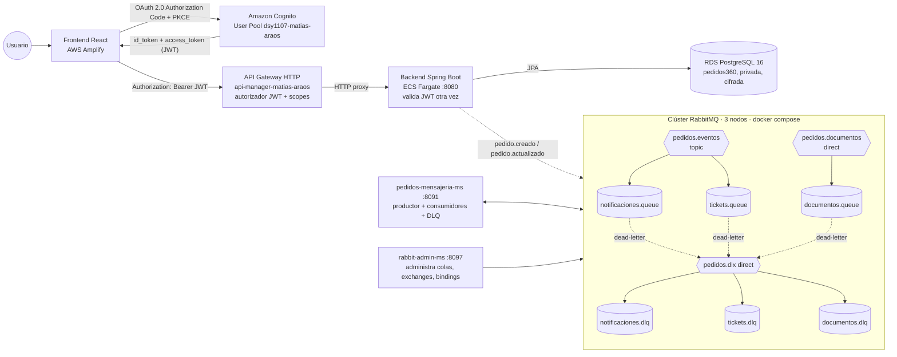
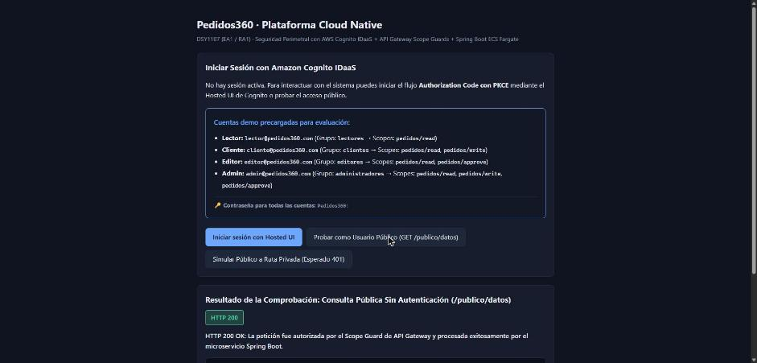
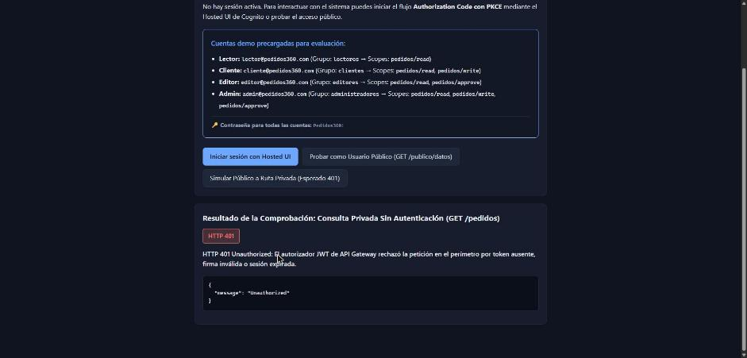
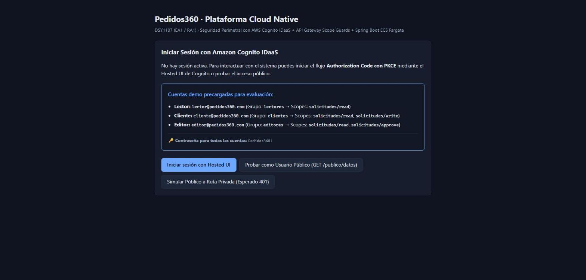
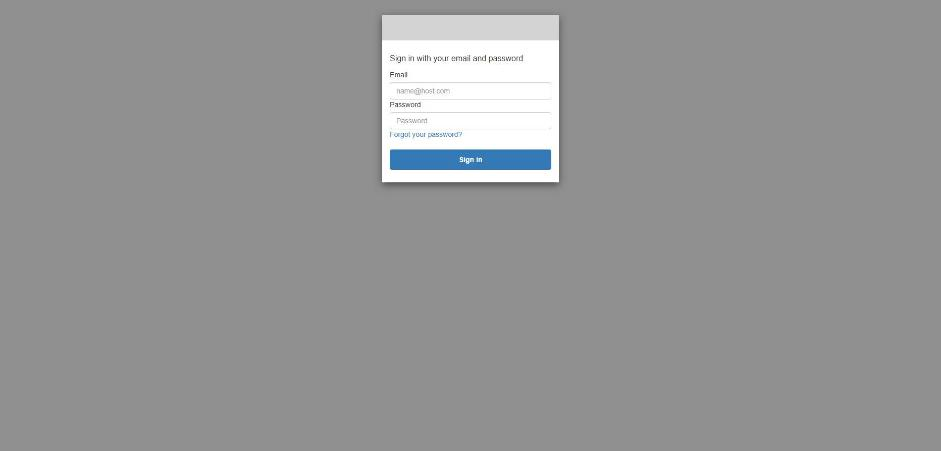
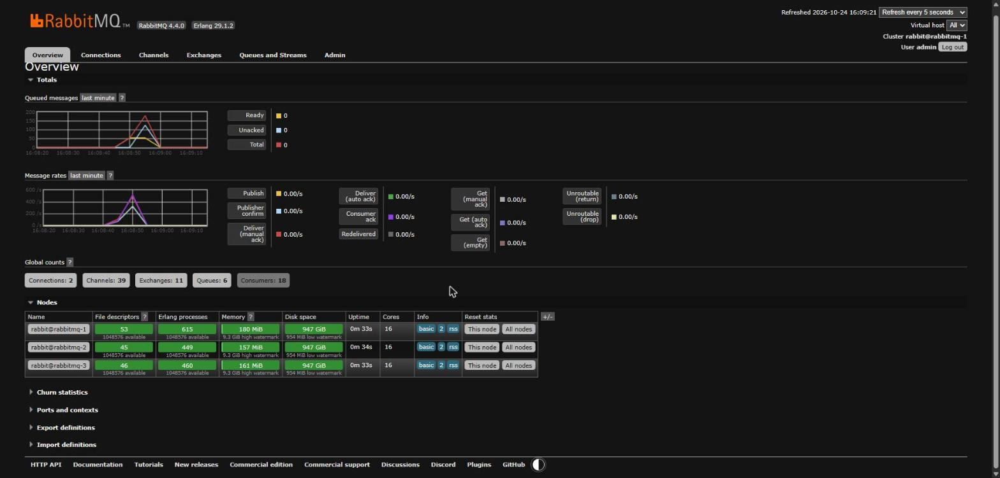
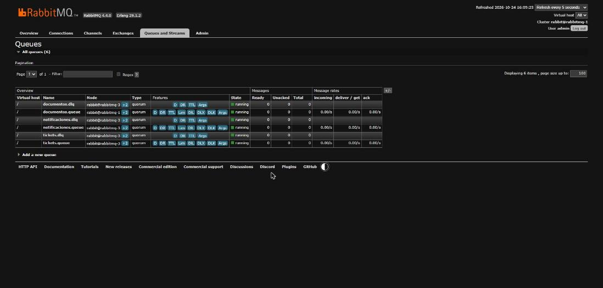
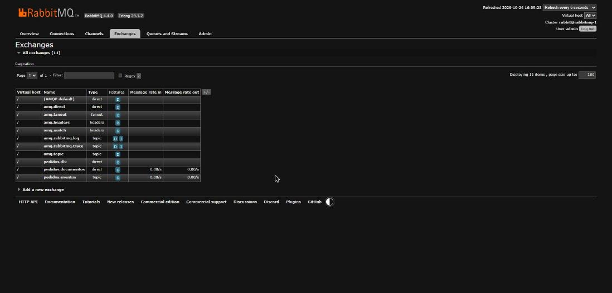

# Informe EP3 / EP4 · Pedidos360 Cloud Native

**Asignatura:** DSY1107 Desarrollo Cloud Native · **Estudiante:** Matías Araos · **Fecha de las evidencias:** 24-10-2026
**Repositorio:** rama `feat/ep3-rabbitmq` · **Región AWS:** us-east-1 (AWS Academy Learner Lab)

Pedidos360 es una plataforma de gestión de pedidos. Un frontend React publicado en AWS Amplify inicia sesión contra Amazon Cognito (IDaaS) mediante OAuth 2.0 / OpenID Connect. Con el JWT obtenido llama al backend Spring Boot, que corre en ECS Fargate detrás de Amazon API Gateway (API Manager) y persiste en RDS PostgreSQL. Las tareas asíncronas (notificaciones, tickets y documentos) viajan por un clúster RabbitMQ con colas de mensajes no entregados (DLQ). Ese clúster se levanta con docker compose y lo consumen dos microservicios Spring Boot.

> Según lo aclarado por la docente, RabbitMQ y los microservicios pueden ejecutarse localmente con Docker Compose. Además, el mismo `docker-compose.yml` se ejecutó en una instancia EC2 de AWS (sección 2.11). También quedó aprobado usar React en lugar de Angular.

---

## 1. Arquitectura



### 1.1 Justificación del diseño y de las tecnologías

| Componente | Tecnología | Por qué |
|---|---|---|
| API Manager | **Amazon API Gateway HTTP API** | Expone un único punto de entrada HTTPS y valida el JWT de Cognito en el perímetro con un autorizador JWT nativo, sin código propio. Exige un *scope* OAuth por ruta (lectura, escritura, aprobación), maneja CORS y es más barato y simple que la REST API para un proxy HTTP. |
| IDaaS | **Amazon Cognito User Pool** | Es un tenant administrado que provee Hosted UI, OAuth 2.0/OIDC, JWKS público, grupos y *resource servers* con scopes propios (`pedidos/read`, `pedidos/write`, `pedidos/approve`). No hay que almacenar contraseñas en la aplicación. |
| Flujo de login | **Authorization Code + PKCE (S256)** | Es el flujo recomendado para una SPA: no hay *client secret* en el navegador y el `code_verifier` impide reutilizar un código interceptado. |
| Backend | **Spring Boot 3.3 / Java 21 en ECS Fargate** | El contenedor se ejecuta sin administrar servidores. Spring Security valida de nuevo el JWT (defensa en profundidad) contra el JWKS de Cognito. |
| Base de datos cloud | **Amazon RDS PostgreSQL 16** | Es una base administrada con almacenamiento cifrado y sin acceso público: su *security group* solo admite el puerto 5432 desde la tarea ECS. El backend la usa con Spring Data JPA. |
| Frontend | **React + Vite en AWS Amplify Hosting** | Hosting estático con HTTPS y CDN. La configuración (Cognito, API) se lee en tiempo de ejecución desde `config.json`, así el mismo build sirve para local y nube. |
| Mensajería | **RabbitMQ 4 (3 nodos, colas quorum)** | Las colas quorum se replican en los 3 nodos (consenso Raft), así que el sistema tolera la caída de un nodo sin perder mensajes. Los exchanges topic y direct desacoplan productores de consumidores. Una DLX con DLQ por cola guarda todo mensaje no entregado. |
| Microservicios | **Spring AMQP** | Usan ACK manual, *publisher confirms* y *returns*, y reintentos acotados antes de enviar a DLQ. |
| Infraestructura | **Terraform** | Toda la infraestructura (Cognito, API Gateway, ECS, RDS, ECR, Amplify) es reproducible y se destruye con un comando, algo clave en un Learner Lab con sesión limitada. |

### 1.2 Seguridad por rol (scopes)

| Usuario demo | Grupo Cognito | Scopes en el access token | GET /pedidos | POST /pedidos |
|---|---|---|---|---|
| lector@pedidos360.com | lectores | pedidos/read | 200 | 403 |
| cliente@pedidos360.com | clientes | pedidos/read, pedidos/write | 200 | 201 |
| editor@pedidos360.com | editores | pedidos/read, pedidos/approve | 200 | 403 |
| admin@pedidos360.com | administradores | read, write, approve | 200 | 201 |

Los scopes se inyectan en el access token según el grupo, mediante el Lambda `user-token-ms` (*pre token generation*).

---

## 2. Evidencias por punto de la presentación

Archivos de evidencia (salida real de comandos, sin secretos):

- [`docs/evidencias/ea1-nube-2026-10-24.txt`](evidencias/ea1-nube-2026-10-24.txt) · API Gateway, Cognito, ECS, RDS y Amplify. Se genera con `scripts/evidencias-nube.sh`.
- [`docs/evidencias/rabbitmq-local-2026-10-24.txt`](evidencias/rabbitmq-local-2026-10-24.txt) · clúster, colas, exchanges, bindings y logs de DLQ.
- [`docs/evidencias/rabbitmq-pruebas-2026-10-24.txt`](evidencias/rabbitmq-pruebas-2026-10-24.txt) · pruebas e2e, de resiliencia y de carga (**55 OK, 0 fallas**).
- [`docs/evidencias/aws-ec2-2026-10-24.txt`](evidencias/aws-ec2-2026-10-24.txt) · docker compose de RabbitMQ ejecutado en EC2.
- [`docs/evidencias/capturas/`](evidencias/capturas/) · capturas de pantalla.

### 2.1 Instancia del API Manager en funcionamiento

API `api-manager-matias-araos` (id `l4wh22q9p8`), protocolo HTTP, endpoint `https://l4wh22q9p8.execute-api.us-east-1.amazonaws.com`, con los stages `$default` y `dev` en auto-deploy. Su CORS solo admite el origen de Amplify y `localhost:5173`. Ver la sección 1 de `ea1-nube-2026-10-24.txt`.

### 2.2 Configuración del API Manager hacia los endpoints del backend

| Ruta | Autorización | Scopes exigidos | Integración (HTTP_PROXY → Fargate) |
|---|---|---|---|
| GET /publico/datos | NONE | — | `http://<ip-tarea>:8080/publico/datos` |
| GET /datos | JWT | openid | `/datos` |
| GET /pedidos, GET /pedidos/{proxy+} | JWT | pedidos/read | `/pedidos`, `/pedidos/{proxy}` |
| POST /pedidos | JWT | pedidos/write | `/pedidos` |
| PUT, DELETE /pedidos/{proxy+} | JWT | pedidos/write o pedidos/approve | `/pedidos/{proxy}` |

El autorizador `cognito-jwt` es de tipo JWT. Toma el token de `Authorization`, usa como issuer `https://cognito-idp.us-east-1.amazonaws.com/us-east-1_p5oJ2xoQK` y como audiencia el client id de la SPA. `scripts/publicar-ecs.sh` reapunta las integraciones a la IP pública de la tarea Fargate en cada despliegue.

### 2.3 El frontend consume los endpoints a través del API Manager

El `config.json` publicado en Amplify define `apiUrl` igual al endpoint de API Gateway, y el *preflight* CORS desde el origen de Amplify responde `204` con `access-control-allow-origin: https://main.d19qegtnjlbhlr.amplifyapp.com` (sección 7 de la evidencia).

| Captura | Qué muestra |
|---|---|
|  | Desde Amplify, `GET /publico/datos` vía API Gateway → **HTTP 200** |
|  | Desde Amplify, `GET /pedidos` sin token → **HTTP 401** del autorizador JWT |

### 2.4 El API Manager valida JWT

```
GET /publico/datos sin token          -> 200
GET /pedidos sin token                -> 401 {"message":"Unauthorized"}
GET /pedidos token malformado         -> 401 {"message":"Unauthorized"}
GET /pedidos firma alterada           -> 401 {"message":"Unauthorized"}
lector  GET /pedidos -> 200   POST /pedidos -> 403 {"message":"Forbidden"}
cliente GET /pedidos -> 200   POST /pedidos -> 201 {"id":6,...}
editor  GET /pedidos -> 200   POST /pedidos -> 403
admin   GET /pedidos -> 200   POST /pedidos -> 201 {"id":7,...}
```

Rechaza los tokens ausentes, malformados o con la firma alterada (**401**), acepta los válidos (**200/201**) y aplica autorización por scope (**403**). `GET /datos` exige el scope `openid`, presente solo en tokens emitidos por el login OIDC del Hosted UI. Por eso el `403` con tokens obtenidos por `USER_PASSWORD_AUTH` en la prueba automatizada es el comportamiento esperado.

### 2.5 Tenant IDaaS y usuarios registrados

- User Pool `dsy1107-matias-araos` (`us-east-1_p5oJ2xoQK`), con dominio Hosted UI `dsy1107-matias-araos.auth.us-east-1.amazoncognito.com`.
- Cliente OAuth `spa-react`: flujo `code`, scopes `openid email profile`, callbacks hacia Amplify y localhost.
- *Resource servers* `pedidos` y `solicitudes` con los scopes `read`, `write` y `approve`.
- **4 usuarios CONFIRMED y habilitados**, cada uno en su grupo (lectores, clientes, editores, administradores). Ver la sección 4 de la evidencia.

### 2.6 El frontend usa OAuth 2.0 / OpenID Connect y obtiene un JWT válido

| Captura | Qué muestra |
|---|---|
|  | Pantalla de login del frontend en Amplify |
|  | Redirección al Hosted UI de Cognito con `response_type=code`, `scope=openid email profile …` y `code_challenge_method=S256` (PKCE) |

El documento *discovery* OIDC del tenant publica `authorization_endpoint`, `token_endpoint` y `jwks_uri`. El ID token emitido trae `iss` igual al User Pool, `aud` igual al client id, `token_use: id`, `email` y `cognito:groups` (sección 5 de la evidencia). Tras el login, la vista **Inspector JWT** del frontend muestra los claims decodificados, y todas las llamadas envían `Authorization: Bearer <access_token>`.

### 2.7 Backend y frontend desplegados, activos e integrados

- **Backend:** servicio ECS `dsy1107-backend-matias-araos` en estado ACTIVE, FARGATE, 1/1 tareas, con la imagen `…/dsy1107-backend-matias-araos:v20261024-185709` en ECR.
- **Base de datos:** RDS `dsy1107-pedidos-matias-araos`, PostgreSQL 16.13, db.t3.micro, *available*, no pública y cifrada. Los logs de CloudWatch muestran `HikariPool-1 - Added connection org.postgresql.jdbc.PgConnection`, y los pedidos creados vía API Gateway quedan persistidos en RDS (ids 4 a 7).
- **Frontend:** app Amplify `dsy1107-Matias-Araos`, job de despliegue `SUCCEED`, `https://main.d19qegtnjlbhlr.amplifyapp.com` responde 200.
- **Integración:** el flujo Amplify → Cognito → API Gateway → ECS → RDS se verificó de punta a punta (secciones 2.3 a 2.6).

### 2.8 Dos (tres) nodos RabbitMQ en clúster

El clúster `rabbit@rabbitmq-1` reporta los Disk Nodes y Running Nodes `rabbitmq-1`, `rabbitmq-2` y `rabbitmq-3` (RabbitMQ 4.4.0). El descubrimiento entre nodos usa `classic_config` y una Erlang cookie compartida. Se usan tres nodos en vez de dos porque las colas quorum necesitan mayoría: con 3 nodos el clúster tolera la caída de uno sin perder disponibilidad.



### 2.9 Tres colas con sus DLQ funcionando

| Cola | Tipo | Políticas | DLQ (vía `pedidos.dlx`) |
|---|---|---|---|
| notificaciones.queue | quorum | TTL 60 s, max-length 1000, delivery-limit 5 | notificaciones.dlq |
| tickets.queue | quorum | ídem | tickets.dlq |
| documentos.queue | quorum | ídem | documentos.dlq |



Las pruebas comprueban que el NACK sin requeue, el REJECT, el error transitorio con los reintentos agotados y la expiración por TTL terminan en la DLQ, con `x-death.reason` igual a `rejected` o `expired`. También comprueban que la DLQ conserva sus mensajes tras reiniciar los 3 nodos. `DlqConsumer` registra cada mensaje no entregado en los logs:

```
ERROR c.D.mensajeria.consumer.dlq.DlqConsumer : [DLQ] cola=notificaciones.dlq origen=notificaciones.queue motivo=rejected veces=1 cuerpo={"pedidoId":103,...,"simularFallo":"PERMANENTE"}
```

### 2.10 Exchanges direct y topic

| Exchange | Tipo | Bindings |
|---|---|---|
| pedidos.eventos | **topic** | `pedido.#` → notificaciones.queue; `pedido.creado` → tickets.queue |
| pedidos.documentos | **direct** | `documento.factura` → documentos.queue |
| pedidos.dlx | **direct** | `*.dead` → la DLQ de cada cola |



Las pruebas verifican el ruteo exclusivo: por ejemplo, `tickets.queue` **no** recibe `pedido.actualizado`, solo `pedido.creado`.

### 2.11 docker-compose levantando RabbitMQ

`messaging/docker-compose.yml` levanta los 3 nodos RabbitMQ y, con el perfil `apps`, los dos microservicios:

```
docker compose --profile apps up -d --build
```

- **Local:** 5 contenedores en ejecución; los 3 nodos en estado *healthy* (`rabbitmq-local-2026-10-24.txt`).
- **En la nube:** el mismo compose se ejecutó en la EC2 `i-075047646bafec5eb`, desplegada con `terraform-rabbitmq/desplegar.sh`. Ahí se verificaron los 3 nodos en *running* y las colas quorum con 3 miembros cada una (`aws-ec2-2026-10-24.txt`). Esa infraestructura se destruyó después de la verificación.

### 2.12 Pruebas de resiliencia y carga

Resultados de `prueba-e2e.sh` y `prueba-resiliencia-carga.sh` (`rabbitmq-pruebas-2026-10-24.txt`):

- 1000 eventos concurrentes generaron 3000 entregas: **ACK = 3000, DLQ = 0, ninguna entrega perdida**, a unas 909 entregas/s.
- Tras reiniciar los 3 nodos, las colas y los mensajes durables se conservan.
- El ruteo del topic y del direct es exclusivo, y el fanout funciona como se espera.

---

## 4. Cumplimiento de los requisitos del encargo

| Requisito | Dónde se cumple |
|---|---|
| Frontend y backend entregados como código fuente | Este repositorio: `frontend/`, `backend/`, `messaging/`, `terraform/` |
| El backend compila, sigue buenas prácticas y pasa pruebas | `backend` tiene 10/10 tests (CI *Backend Compile* en verde). `pedidos-mensajeria-ms` tiene 6 tests (`ConfirmacionManualTest`) y `rabbit-admin-ms` 7 (`RabbitAdminControllerTest`), ambos en CI *Messaging CI*. |
| Frontend completo, modular, sin errores y con vistas funcionales | `frontend/src/App.jsx` orquesta la app, con 9 componentes en `src/components/` (login, sesión, pedidos, Scope Guard, Inspector JWT, resultado) y los permisos por rol en `src/roles.js` con 5 tests. `npm run build` compila sin errores (CI *Frontend Compile* en verde). |
| Integración con la base de datos cloud | La entidad JPA `model/Pedido` y el repositorio `repository/PedidoRepository` (Spring Data JPA) están en el backend. Las propiedades `spring.datasource.*` se leen de variables de entorno inyectadas por la tarea ECS hacia RDS (`terraform/rds.tf`, `terraform/ecs.tf`). |
| Filtros de validación de JWT en el backend | `config/SecurityConfig.java` configura `oauth2ResourceServer().jwt()` con un `NimbusJwtDecoder` contra el JWKS e issuer de Cognito, y declara rutas públicas y protegidas. |
| Login con IDaaS y uso del JWT en el frontend | `src/auth.js` implementa Authorization Code + PKCE, el canje del code, el refresh y el logout. `src/api.js` envía `Authorization: Bearer` en cada llamada. |
| .gitignore por tecnología | `backend/.gitignore` (Maven/target, IDE), `frontend/.gitignore` (node_modules, dist, .env), `.gitignore` raíz (Terraform state, tfplan, .terraform) y los de cada microservicio. |
| Productores y consumidores RabbitMQ | En `pedidos-mensajeria-ms`, `PedidoEventPublisher` es el productor y `NotificacionConsumer`, `TicketConsumer` y `DocumentoConsumer` son los consumidores. El backend también publica `pedido.creado` y `pedido.actualizado` (`messaging/PedidoEventPublisher`). |
| Mensajes no entregados a la DLQ y registrados en logs | `ConfirmacionManual` hace ACK, reintenta con un contador `x-reintentos` y, al agotarlo, NACK o REJECT a la DLX. `DlqConsumer` registra cada mensaje con su cola de origen, motivo y número de intentos. |
| Administrador de colas, exchanges y bindings | `rabbit-admin-ms` expone `POST/DELETE /api/rabbitmq/queues`, `POST/DELETE /api/rabbitmq/exchanges` (direct, topic, fanout, headers) y `POST/DELETE /api/rabbitmq/bindings`, más info, purge y alertas. Responde 400, 404, 409 o 503 según el caso. Verificado en la sección 7 de la prueba e2e. |

---

## 5. Cómo reproducir

```bash
# Infraestructura cloud (Cognito, API Gateway, ECS, RDS, ECR, Amplify)
./scripts/toolbox.sh terraform -chdir=terraform apply
./scripts/toolbox.sh ./scripts/publicar-ecs.sh                 # backend → ECR → ECS + reapunta API Gateway
cd frontend && npm ci && npm run build && cd ..
./scripts/toolbox.sh bash -c 'REGION=us-east-1 COGNITO_DOMAIN=... CLIENT_ID=... \
  REDIRECT_URI=https://main.<app>.amplifyapp.com/ API_URL=https://<api>.execute-api.us-east-1.amazonaws.com \
  EXIGIR_HTTPS=1 DESTINO=frontend/dist/config.json ./scripts/config-frontend.sh && \
  ./scripts/publicar-amplify.sh <app-id> main frontend/dist'
./scripts/toolbox.sh ./scripts/evidencias-nube.sh               # regenera la evidencia
./scripts/toolbox.sh terraform -chdir=terraform destroy -auto-approve

# Mensajería
cd messaging && docker compose --profile apps up -d --build
bash scripts/prueba-e2e.sh && bash scripts/prueba-resiliencia-carga.sh
```

`scripts/toolbox.sh` ejecuta Terraform, AWS CLI, jq y Java 21 dentro de un contenedor, para no depender de lo instalado en el equipo. El detalle de la mensajería está en [`docs/EP3_RABBITMQ.md`](EP3_RABBITMQ.md).

## 6. Limitaciones conocidas

- **IP de la tarea:** API Gateway apunta a la IP pública de la tarea Fargate y se reapunta en cada despliegue. Con más presupuesto se usaría un ALB o VPC Link, que el Learner Lab limita.
- **Credenciales de la base:** la contraseña de RDS se inyecta como variable de entorno de la tarea. En producción iría en Secrets Manager.
- **Backend sin RabbitMQ en la nube:** el backend en la nube no alcanza el RabbitMQ local, así que registra el fallo de publicación y sigue respondiendo (la publicación es *best effort*). La publicación de eventos del backend se verificó en local.
